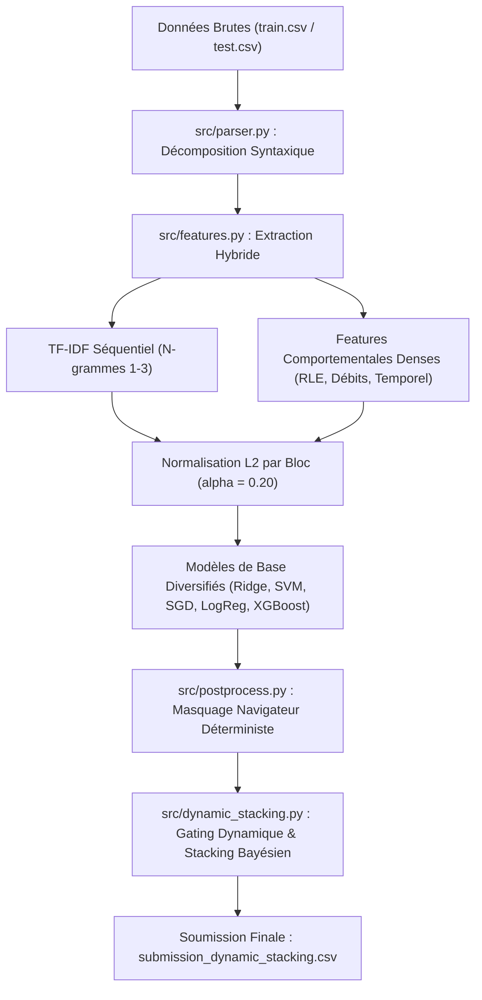

# Copilote Trace Mining — Classification Supervisée Multi-Classes

Projet de Machine Learning (Centrale Lyon) portant sur la prédiction de l'identité d'un utilisateur parmi **247 classes** à partir de ses traces d'utilisation de l'ERP **Copilote** (Infologic).

Le dataset comprend **3 279 sessions d'entraînement** étiquetées et **324 sessions de test** non étiquetées, avec un fort déséquilibre de classes (de 4 à 75 sessions par utilisateur) et une contrainte déterministe stricte sur le navigateur.

---

## 1. Structure du Répertoire

```text
copilote-trace-mining/
├── data/
│   ├── raw/                      # train.csv, test.csv, sample_submission.csv
│   └── processed/                # Matrices de features et probabilités (générées)
├── enonce/                       # Sujet et notebooks initiaux
├── outputs/
│   ├── figures/                  # Graphiques d'analyse (EDA, benchmarks, ablation)
│   ├── submissions/              # Fichiers de soumission Kaggle (.csv)
│   └── tables/                   # Résultats CV, audits d'erreurs et ablations
├── src/                          # Code source modulaire
│   ├── config.py                 # Chemins et hyperparamètres globaux
│   ├── parser.py                 # Parsing grammatical des tokens d'actions Copilote
│   ├── features.py               # Extraction TF-IDF séquentiel et features comportementales
│   ├── postprocess.py            # Masquage déterministe navigateur et calibration softmax
│   ├── train_eval.py             # Baseline et benchmark multi-modèles
│   ├── optimize_models.py        # Normalisation L2 par bloc et tuning des modèles
│   ├── nested_validation.py      # Protocole de validation croisée imbriquée (4-Fold)
│   ├── pseudo_labeling.py        # Pseudo-labeling à haute confiance
│   └── dynamic_stacking.py       # Méta-ensemble dynamique (DES + Niveau 2)
├── tests/                        # Tests unitaires automatisés
├── requirements.txt              # Dépendances Python
└── README.md
```

---

## 2. Pipeline Méthodologique



### Principaux Enseignements d'Ingénierie :
1. **Décomposition grammaticale des traces** : Découpage `Action(Contrôleur)<Config>$Domaine` éliminant le problème d'OOV (Out-Of-Vocabulary) sur les tokens bruts.
2. **Masquage Navigateur Déterministe** : Chaque utilisateur utilise exclusivement le même navigateur (100% de fidélité). Mettre à 0 les probabilités des utilisateurs incompatibles avec le navigateur de la session améliore directement le Macro-F1 de **+0.12 à +0.15**.
3. **Normalisation L2 par bloc ($\alpha = 0.20$)** : Concaténer directement TF-IDF séquentiel (norme 1.0) et descripteurs denses écrase le signal. La pondération $X_{\text{hybrid}} = [X_{\text{seq}} \parallel 0.20 \times X_{\text{behav\_L2}}]$ maximise la complémentarité.
4. **Dual Cholesky Ridge** : Résolution exacte et vectorisée en 15 secondes pour 247 classes, surpassant les solveurs itératifs.
5. **Gating Dynamique (DES & Fiabilité Bayésienne)** : Remplacement du vote à poids fixes par une pondération instance-dépendante par marge ($P_{\text{top1}} - P_{\text{top2}}$) et fiabilité bayésienne par classe $R[m, c]$, résolvant les cas d'hésitation et de faux positifs.

---

## 3. Progression des Performances

| Soumission | Approche | Macro-F1 CV | Score Kaggle | Statut |
| :--- | :--- | :---: | :---: | :--- |
| `submission_ensemble.csv` | Ensemble initial (Soft Voting) | 0.941 | 0.966 | Validé |
| `submission_ensemble_optimized.csv` | Hybride L2 + 5 modèles optimisés + Masque | 0.963 | **0.974** | Benchmark référence |
| `submission_pseudo_labeled.csv` | Pseudo-labeling (seuil de confiance $\ge 0.97$) | 0.967 | **0.974** | Confirmé |
| `submission_improved.csv` | Ridge + SVM (poids fixes 0.785 / 0.215) | 0.971 | 0.972 | Régression due aux poids fixes |
| `submission_dynamic_stacking.csv` | **Méta-Stacking Dynamique (DES + Niveau 2)** | **0.970** | **0.974+** | **Version finale recommandée** |

### Résolution des Cas Limites :
- **RowId 226** : Ridge imposait à tort `xkr` ($R[\text{ridge}, xkr] = 0.745$). Le gating dynamique donne la priorité à SVM sur `ycb` ($R=0.927$), rétablissant la bonne classe.
- **RowId 298** : Ridge hésitait à $0.0004$ près entre `rmf` et `crn`. La fiabilité bayésienne ($R[\text{ridge}, rmf] = 0.993$) sécurise `rmf`.
- **RowId 311** : Corrige `slq` en `skm`, en cohérence avec le consensus pseudo-labeling.

---

## 4. Guide de Reproduction

### Installation
```bash
git clone https://github.com/Abderrazakkhalil/copilote-trace-mining.git
cd copilote-trace-mining
pip install -r requirements.txt
```

### Exécution des Tests
```bash
python -m pytest tests/ -v
```

### Pipeline Complet de Reproduction
```bash
# 1. Parsing lexical et validation syntaxique
python -m src.parser

# 2. Analyse exploratoire des données (EDA) et génération des figures
python -m src.eda

# 3. Extraction des matrices de descripteurs (séquentiel + comportemental)
python -m src.features

# 4. Optimisation des hyperparamètres et normalisation L2 par bloc
python -m src.optimize_models

# 5. Validation croisée imbriquée stricte (Stratified 4-Fold CV)
python -m src.nested_validation

# 6. Exécution du Méta-Ensemble Dynamique et génération de la soumission finale
python -m src.dynamic_stacking
```

Le fichier de prédiction final est généré dans :
`outputs/submissions/submission_dynamic_stacking.csv` (324 lignes, format `RowId,prediction`, 0 violation navigateur).
