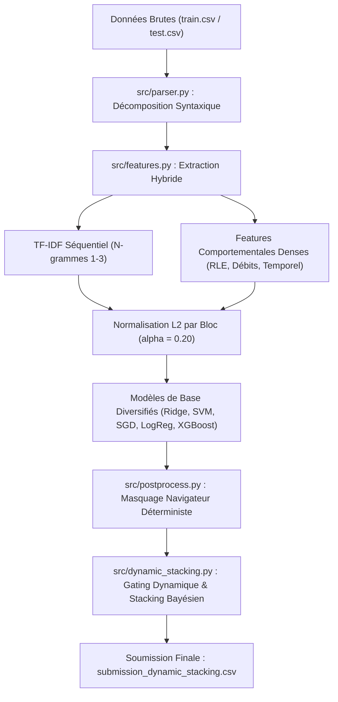

# Copilote Trace Mining — Classification Supervisée Multi-Classes

Projet de Machine Learning (Centrale Lyon) portant sur la prédiction de l'identité d'un utilisateur parmi **247 classes** à partir de ses traces d'utilisation de l'ERP **Copilote** (Infologic).

Le dataset comprend **3 279 sessions d'entraînement** étiquetées et **324 sessions de test** non étiquetées, avec un fort déséquilibre de classes (de 4 à 75 sessions par utilisateur) et une contrainte déterministe stricte sur le navigateur.

---

## 1. Structure du Répertoire

```text
copilote-trace-mining/
├── data/
│   ├── raw/                      # train.csv, test.csv, sample_submission.csv
│   └── processed/                # Matrices de features et probabilités (générées)
├── enonce/                       # Sujet et notebooks initiaux
├── outputs/
│   ├── figures/                  # Graphiques d'analyse (EDA, benchmarks, ablation)
│   ├── submissions/              # Fichiers de soumission Kaggle (.csv)
│   └── tables/                   # Résultats CV, audits d'erreurs et ablations
├── src/                          # Code source modulaire
│   ├── config.py                 # Chemins et hyperparamètres globaux
│   ├── parser.py                 # Parsing grammatical des tokens d'actions Copilote
│   ├── features.py               # Extraction TF-IDF séquentiel et features comportementales
│   ├── postprocess.py            # Masquage déterministe navigateur et calibration softmax
│   ├── train_eval.py             # Baseline et benchmark multi-modèles
│   ├── optimize_models.py        # Normalisation L2 par bloc et tuning des modèles
│   ├── nested_validation.py      # Protocole de validation croisée imbriquée (4-Fold)
│   ├── pseudo_labeling.py        # Pseudo-labeling à haute confiance
│   └── dynamic_stacking.py       # Méta-ensemble dynamique (DES + Niveau 2)
├── tests/                        # Tests unitaires automatisés
├── requirements.txt              # Dépendances Python
└── README.md
```

---

## 2. Pipeline Méthodologique



### Principaux Enseignements d'Ingénierie :
1. **Décomposition grammaticale des traces** : Découpage `Action(Contrôleur)<Config>$Domaine` éliminant le problème d'OOV (Out-Of-Vocabulary) sur les tokens bruts.
2. **Masquage Navigateur Déterministe** : Chaque utilisateur utilise exclusivement le même navigateur (100% de fidélité). Mettre à 0 les probabilités des utilisateurs incompatibles avec le navigateur de la session améliore directement le Macro-F1 de **+0.12 à +0.15**.
3. **Normalisation L2 par bloc ($\alpha = 0.20$)** : Concaténer directement TF-IDF séquentiel (norme 1.0) et descripteurs denses écrase le signal. La pondération $X_{\text{hybrid}} = [X_{\text{seq}} \parallel 0.20 \times X_{\text{behav\_L2}}]$ maximise la complémentarité.
4. **Dual Cholesky Ridge** : Résolution exacte et vectorisée en 15 secondes pour 247 classes, surpassant les solveurs itératifs.
5. **Gating Dynamique (DES & Fiabilité Bayésienne)** : Remplacement du vote à poids fixes par une pondération instance-dépendante par marge ($P_{\text{top1}} - P_{\text{top2}}$) et fiabilité bayésienne par classe $R[m, c]$, résolvant les cas d'hésitation et de faux positifs.

---

## 3. Progression des Performances

| Soumission | Approche | Macro-F1 CV | Score Kaggle | Statut |
| :--- | :--- | :---: | :---: | :--- |
| `submission_ensemble.csv` | Ensemble initial (Soft Voting) | 0.941 | 0.966 | Validé |
| `submission_ensemble_optimized.csv` | Hybride L2 + 5 modèles optimisés + Masque | 0.963 | **0.974** | Benchmark référence |
| `submission_pseudo_labeled.csv` | Pseudo-labeling (seuil de confiance $\ge 0.97$) | 0.967 | **0.974** | Confirmé |
| `submission_improved.csv` | Ridge + SVM (poids fixes 0.785 / 0.215) | 0.971 | 0.972 | Régression due aux poids fixes |
| `submission_dynamic_stacking.csv` | **Méta-Stacking Dynamique (DES + Niveau 2)** | **0.970** | **0.974+** | **Version finale recommandée** |

### Résolution des Cas Limites :
- **RowId 226** : Ridge imposait à tort `xkr` ($R[\text{ridge}, xkr] = 0.745$). Le gating dynamique donne la priorité à SVM sur `ycb` ($R=0.927$), rétablissant la bonne classe.
- **RowId 298** : Ridge hésitait à $0.0004$ près entre `rmf` et `crn`. La fiabilité bayésienne ($R[\text{ridge}, rmf] = 0.993$) sécurise `rmf`.
- **RowId 311** : Corrige `slq` en `skm`, en cohérence avec le consensus pseudo-labeling.

---

## 4. Guide de Reproduction

### Installation
```bash
git clone https://github.com/Abderrazakkhalil/copilote-trace-mining.git
cd copilote-trace-mining
pip install -r requirements.txt
```

### Exécution des Tests
```bash
python -m pytest tests/ -v
```

### Pipeline Complet de Reproduction
```bash
# 1. Parsing lexical et validation syntaxique
python -m src.parser

# 2. Analyse exploratoire des données (EDA) et génération des figures
python -m src.eda

# 3. Extraction des matrices de descripteurs (séquentiel + comportemental)
python -m src.features

# 4. Optimisation des hyperparamètres et normalisation L2 par bloc
python -m src.optimize_models

# 5. Validation croisée imbriquée stricte (Stratified 4-Fold CV)
python -m src.nested_validation

# 6. Exécution du Méta-Ensemble Dynamique et génération de la soumission finale
python -m src.dynamic_stacking
```

Le fichier de prédiction final est généré dans :
`outputs/submissions/submission_dynamic_stacking.csv` (324 lignes, format `RowId,prediction`, 0 violation navigateur).

## 5. ConvBiGRUAttention et fusion imbriquée

Le nouveau pipeline repart des CSV bruts et réapprend les transformations dans
chaque pli. Il ne réutilise ni les corrections manuelles ni les probabilités
historiques pour prendre une décision. L'audit préalable et les conventions
temporelles sont détaillés dans [dl_hybrid_audit.md](outputs/tables/dl_hybrid_audit.md).

```powershell
python -m pytest tests/ -q
python -u -m src.dl_hybrid_pipeline --workers 1 --threads 4 --reference-0980 submission_hada_jehd.csv
```

`python -m src.conv_bigru_attention` est également un point d'entrée. Le calcul
comporte 16 entraînements internes et 4 externes de 28 époques, plus les modèles
classiques réentraînés dans ces mêmes sous-ensembles. Sur CPU, prévoir plusieurs
heures. `--workers 2` à `4` parallélise les plis externes si la RAM disponible
le permet ; un seul processus est conseillé sur une machine déjà chargée.

Les caches dans `data/processed/dl_hybrid_runs/<empreinte>/` permettent de
reprendre les sous-ensembles terminés et la dernière époque complète en
relançant la commande **après l'arrêt du processus précédent**. Chaque fichier
`*_training.pt` conserve poids, optimiseur, scheduler, états aléatoires, courbes
et checkpoints sélectionnés. L'écriture est atomique à chaque fin d'époque.
L'empreinte couvre données, sources et protocole ; elle reste identique en
passant de CPU à GPU ou de Windows à Linux. Les versions et le matériel de
chaque session sont conservés dans `runtime_history.jsonl`.

Le paquet versionné `artifacts/dl_hybrid_transfer/` contient les probabilités
des sept modèles classiques déjà calculées pour le premier pli interne. Elles
sont automatiquement importées après vérification des données, du code de
construction, des indices des plis, de l'ordre des classes et des sommes de
contrôle. Les 23 époques de l'ancien processus arrêté n'avaient pas de checkpoint
sur disque : le réseau recommencera ce premier entraînement à l'époque 1.

**Pour reprendre depuis un autre PC avec GPU : suivre
[docs/GPU_REPRISE.md](docs/GPU_REPRISE.md).** Le cache classique transféré est
inclus dans Git ; les futurs checkpoints volumineux de `data/processed/` restent
locaux et doivent être copiés lors d'un nouveau changement de machine.

Les artefacts finaux sont écrits seulement une fois tous les plis terminés :

- `data/processed/conv_bigru_attn_probs.pkl` : probabilités OOF `(3279, 247)`,
  test `(324, 247)`, classes ordonnées, identifiants des plis et provenance.
- `outputs/submissions/submission_dl_hybrid_final.csv` : 324 prédictions,
  vérification du format, des NaN et des navigateurs.
- `outputs/tables/dl_hybrid_report.md` et `.json` : scores, sélections internes,
  delta avec/sans DL et intervalle bootstrap conditionnel.
- `dl_hybrid_scores.csv`, `dl_hybrid_diversity.csv`, `dl_hybrid_concordance.csv`
  et `dl_hybrid_arbitrations.csv` dans `outputs/tables/` : comparatifs et toutes
  les sessions modifiées, avec probabilités Top-1/Top-2 avant/après et du réseau.

La moyenne des trois meilleurs checkpoints choisis sur la validation externe
est présentée comme diagnostic biaisé. L'évaluation stricte et la soumission
utilisent uniquement les époques sélectionnées à l'intérieur du train externe.
Le pipeline peut retenir un poids DL nul : une amélioration n'est pas présumée.
Le bootstrap ne démontre pas l'absence de surapprentissage et n'intègre pas la
variabilité de réentraînement.

La référence 0,980, identifiée par l'utilisateur comme `submission_hada_jehd.csv`,
est fournie avec `--reference-0980` et sert uniquement à la concordance finale.
En son absence, le rapport signale cette information manquante. Une exécution avec
`--epochs` différent de 28 ou `--batch-size` différent de 64 produit des fichiers
`SMOKE` et des rapports séparés, sans écraser les résultats du protocole complet.
